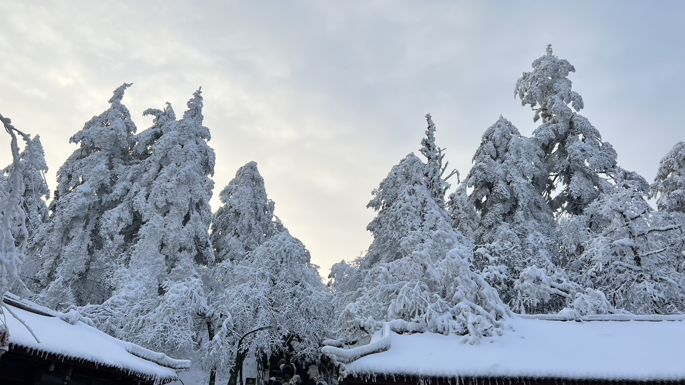
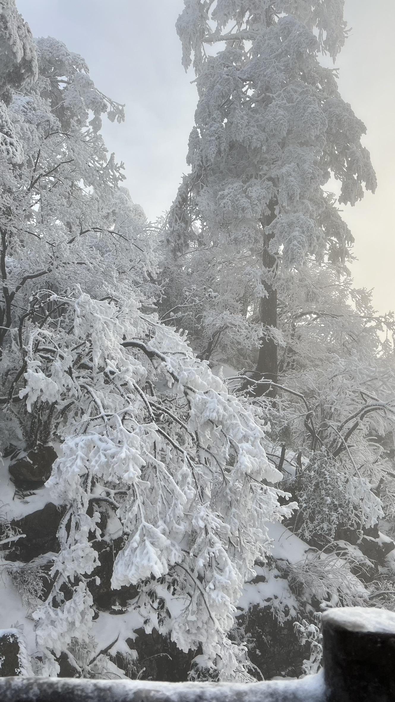
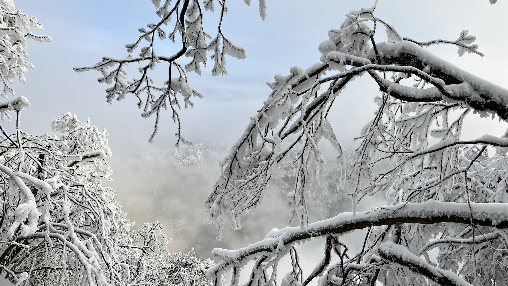
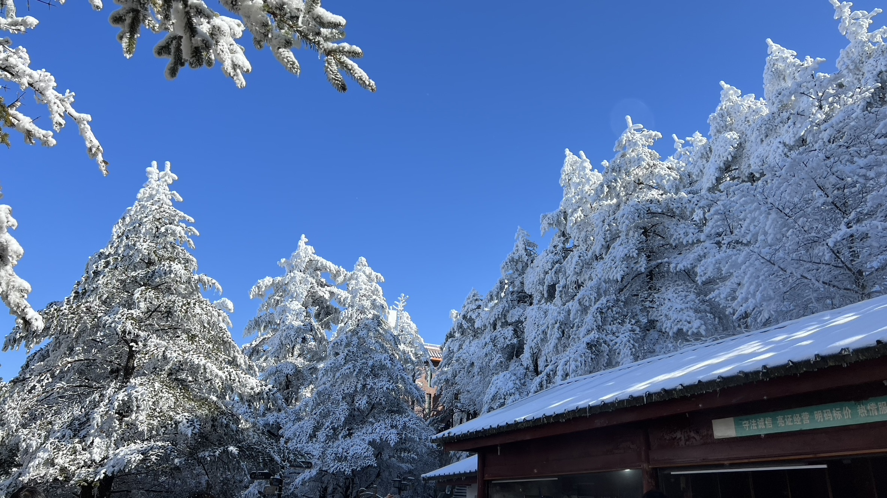
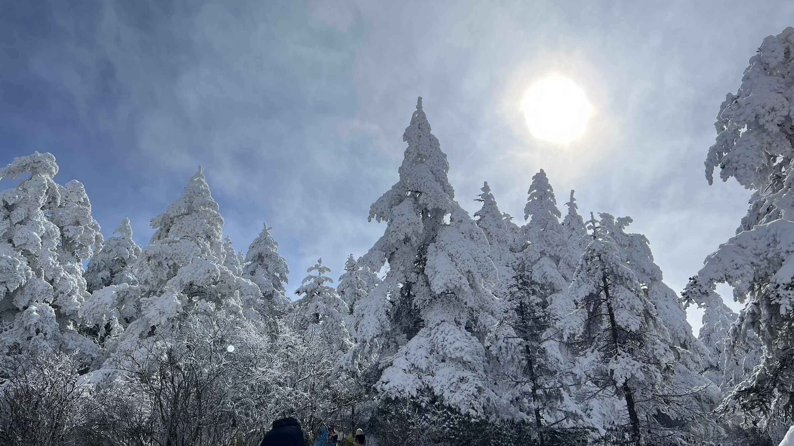

# 峨眉山｜雪落在松针上

2023 年 1 月 1 日 · 峨眉山

周日，元旦。八点半在雷洞坪下车，山下的天气到这里就不作数了。零下的空气，路两边全是被雪压住的杉树，屋檐下挂着一排冰凌。从雷洞坪往上走一公里半到接引殿，再换索道；出索道站就是金顶，海拔 3079 米。

## 八点半，雷洞坪

观光车的终点站。下车先看见的不是山，是屋顶——深色的瓦上积了厚厚一层雪，檐口垂下来一整排冰凌，长的有一尺。树都比房子高，枝上挂的雪压得弯下去，像随时会掉，其实很结实。

海拔 2430 米，空气干得发脆。哈出来的气是白的，手一会儿就不听使唤，拍两张就得塞回口袋。

## 往接引殿的一公里半

从雷洞坪到接引殿一公里半，台阶步道，正常走半小时。路面结了冰，走得很慢，脚底下要踩实。

路边有一丛枝条被雪压弯了，弯到快要碰到石头，雪在枝上结成一簇一簇的，像棉花挂在线上。背景是雾，白得没有层次。

## 雾底下是空的

有一段栏杆外是山谷。树枝从上方垂下来，把视线切成一格一格，空隙里全是雾。

雾不是平的，是流动的，从下往上漫，慢慢把对面的树也吃掉。凑近栏杆往下看，什么都看不见——不知道底下是三百米还是三千米。后来才知道，那块空就是云海。

九点在接引殿排队。索道五分钟上顶，队伍排了一个多小时。这一段没拍——排队的人挤在一起，拍不出什么。

## 山顶的租衣摊

十点半出索道站，往金顶平台走。天忽然全蓝了，太阳一出来，雪反光得睁不开眼。

平台边上有一排棚子，屋檐同样挂着冰凌。檐下一块绿底白字的牌子，写着「守法诚信」「明码标价」「特价租赁」——租棉衣、租防滑鞋的。上山穿得少的人都在这里补装备。

金顶这半天人很多。台阶上、栏杆边、观景台，几乎每一处能站人的地方都站着人，都举着手机。真正好的是抬头——树顶以上全是空的，蓝得没有一丝杂色。

## 太阳在树梢上

十二点四十，太阳移到右上方，被薄云挡了一层，成了一团白。光从树梢后面打过来，雪变成灰蓝的，树枝的轮廓反而清楚。

一排杉树就这样顶着雪站成一列，尖上一个接一个。风一过，树上的雪簌簌往下掉，落在肩上，一会儿就化。

下山还是原路：金顶索道到接引殿，接引殿走回雷洞坪，再坐两小时观光车。到山脚的时候天已经黑了，鞋上的雪化成水，一路滴。

山下的成都没下雪。那天是元旦。
