# 四姑娘山｜山在云上，水在林间

2023 年 9 月 2 日 · 四姑娘山

九月的第一个周末去了四姑娘山，两天。第一天进沟，看了水、枯树和草甸；第二天回到沟口，记住的几乎只剩水声。

## 沟的尽头是雪峰

进沟的路两边先是密密的针叶林，走了没多久，前面忽然空出来一片水——湖是青绿色的，岸边立着一大片白色的枯树干，一根根扎在水里，树皮早掉光了，白得发亮。雪峰在湖的那一头，只露出一角。

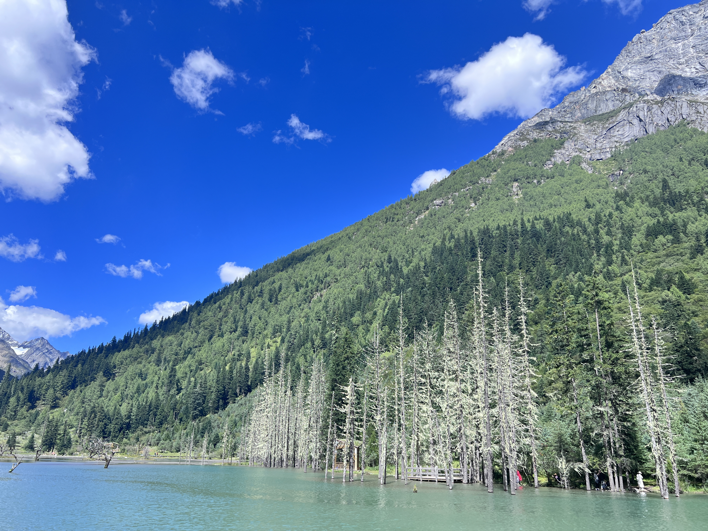

再往开阔处走，雪峰才整排露出来：尖的一排，覆着雪，云在峰腰上慢慢地挪。

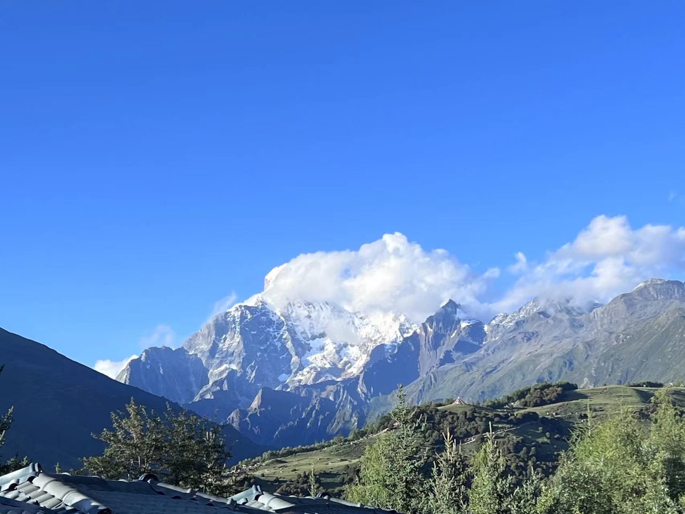

再往里走，岩壁就在头顶上了。灰白色的石头，纹路是斜的，一层压着一层，抬头要仰到脖子发酸。

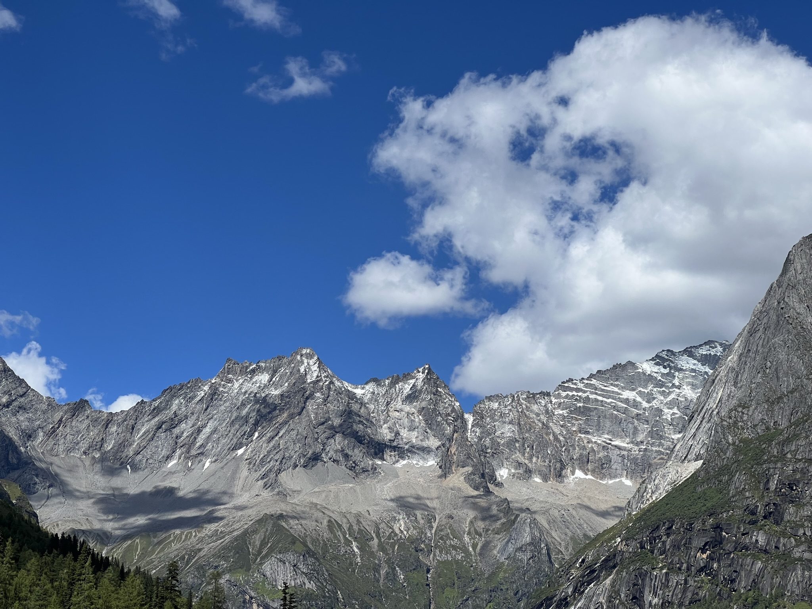

## 水里站着的枯树

湖浅的地方，立着一片早就死掉的树。水面一点风都没有，倒影比树本身还清楚——黑灰的枝干，一根根折向上方，水里的那一份一模一样。

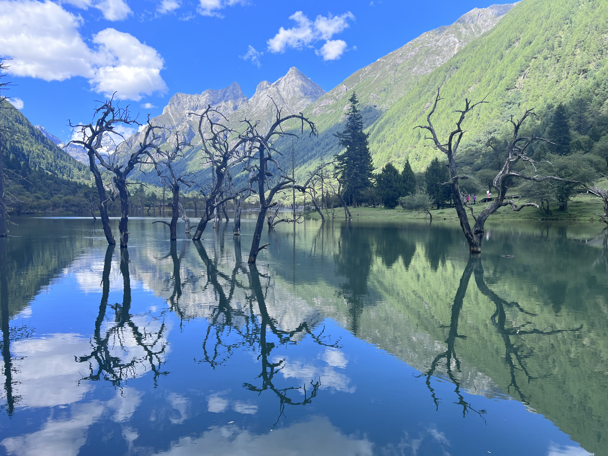

走近了看，树干发白发灰，下半截留着一圈圈水位的痕迹。水是青绿的，深的地方发暗，能看见底下横着的倒木。

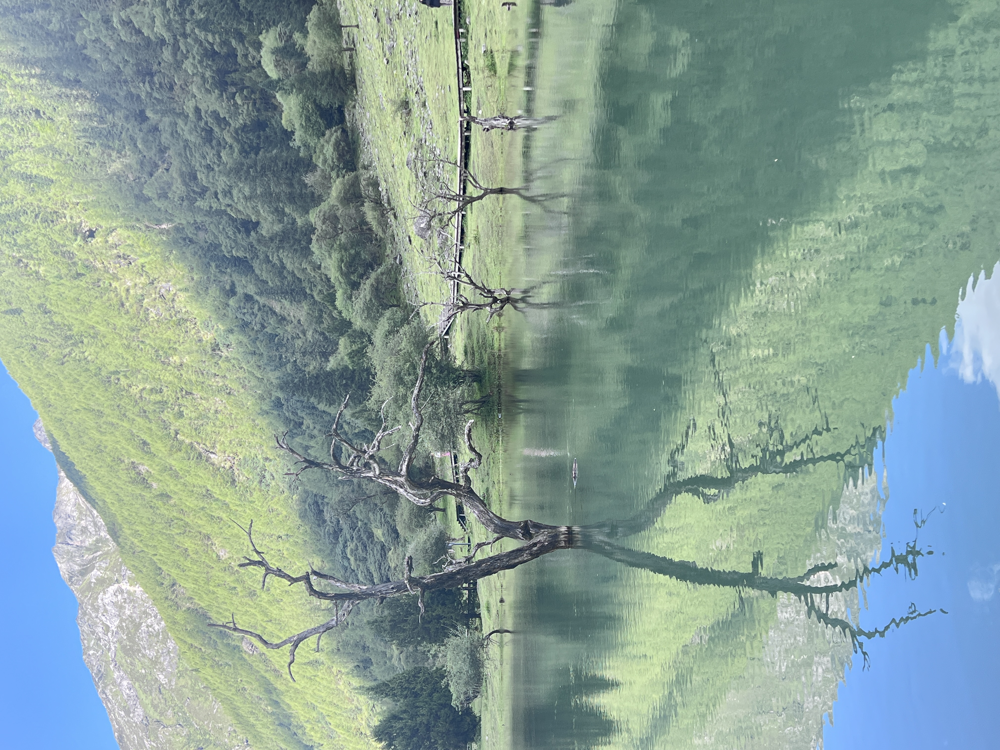

湖的另一侧有水流下来，从石头上漫过去，溅起一片白。远处还是雪峰，还是枯树。

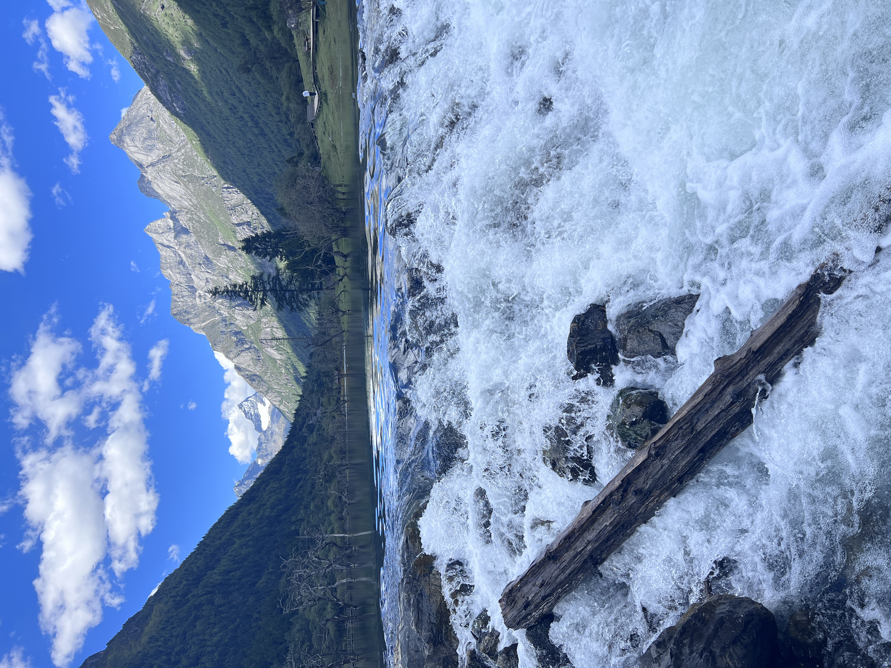

## 草地、白塔与云影

下午两点多，走到一片草甸。木栅栏沿着栈道一路围过去，草是黄绿混着的，远处有一座白塔，几头牛散在坡上低头吃草，远看只是几个黑点。

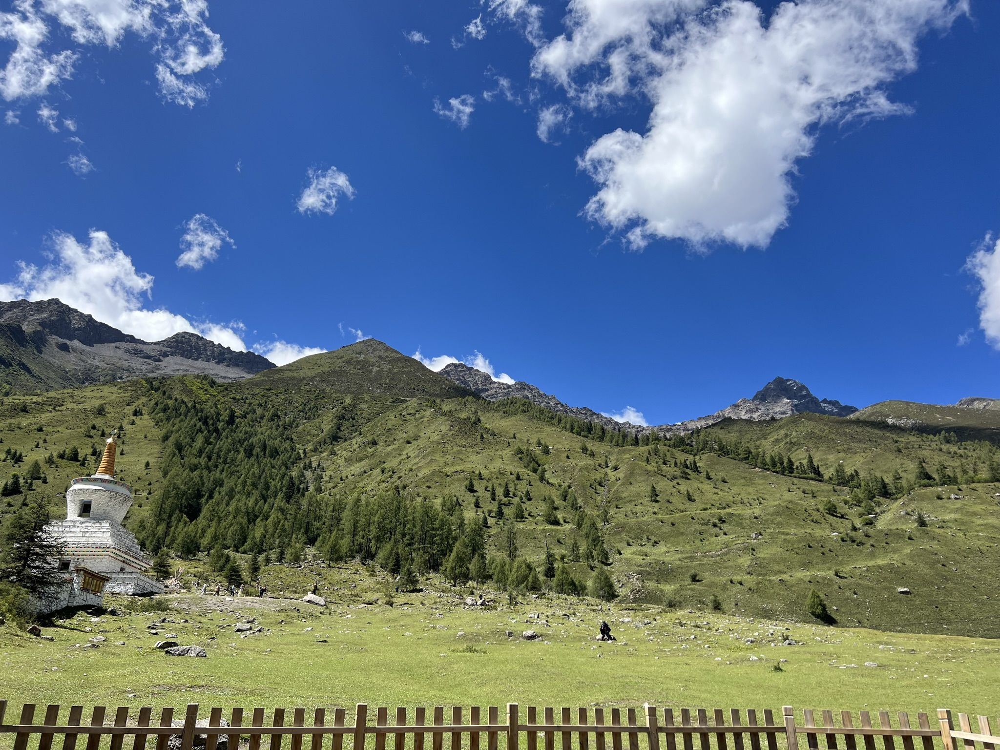

云从山那边过来，影子一块一块轮流放在坡上。山脊一层压着一层，最后面那层是灰白的岩峰。

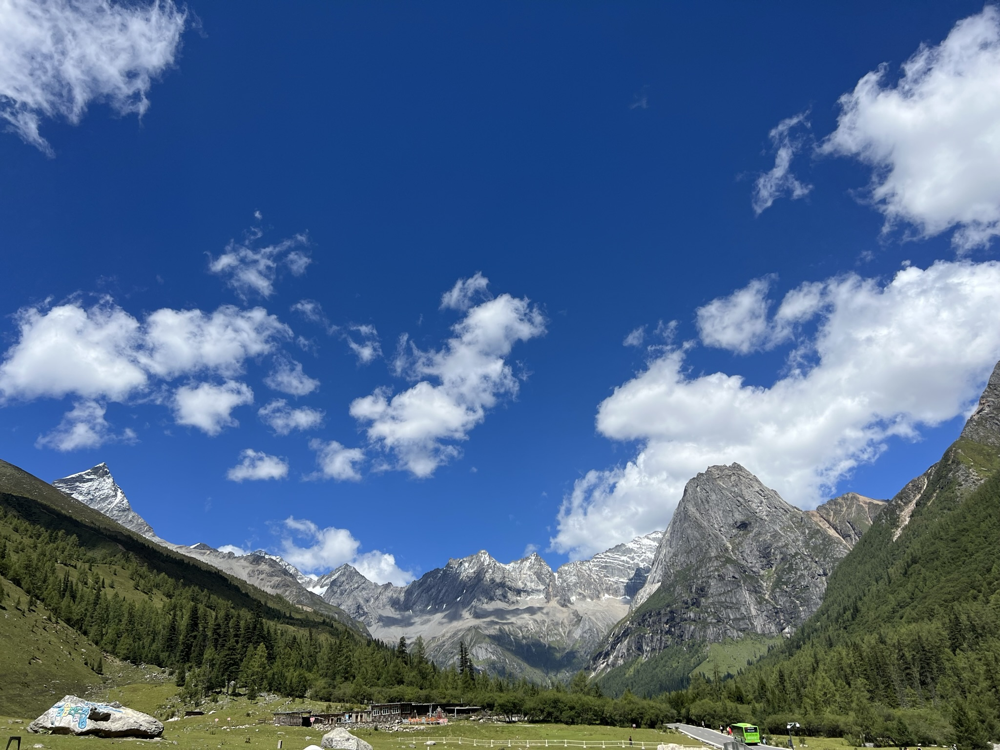

回头看，雪峰从绿色里升起来，云就挂在它的肩上。

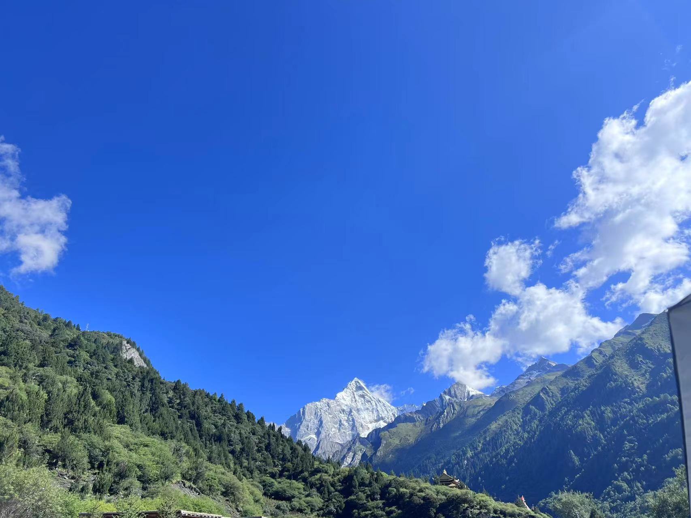

## 石塔与风

路边用石头砌起一座座玛尼堆，塔身嵌满刻过字的石子，红的、黄的、绿的都有，顶上插着经幡。风从河谷里过来，站在那儿一会儿就够了。

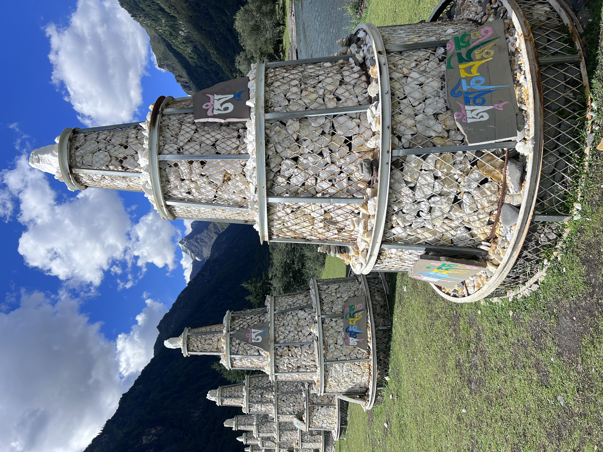

## 水声

第二天上午十一点多，又回到沟口一带。这一天的记忆几乎全是水声：溪流从石头之间穿过去，水是青灰的，翻白的地方很亮。

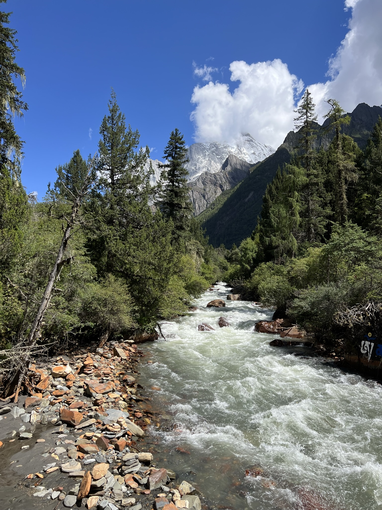

木桥横在河上，草地一直铺到水边，再往后是深绿色的森林。

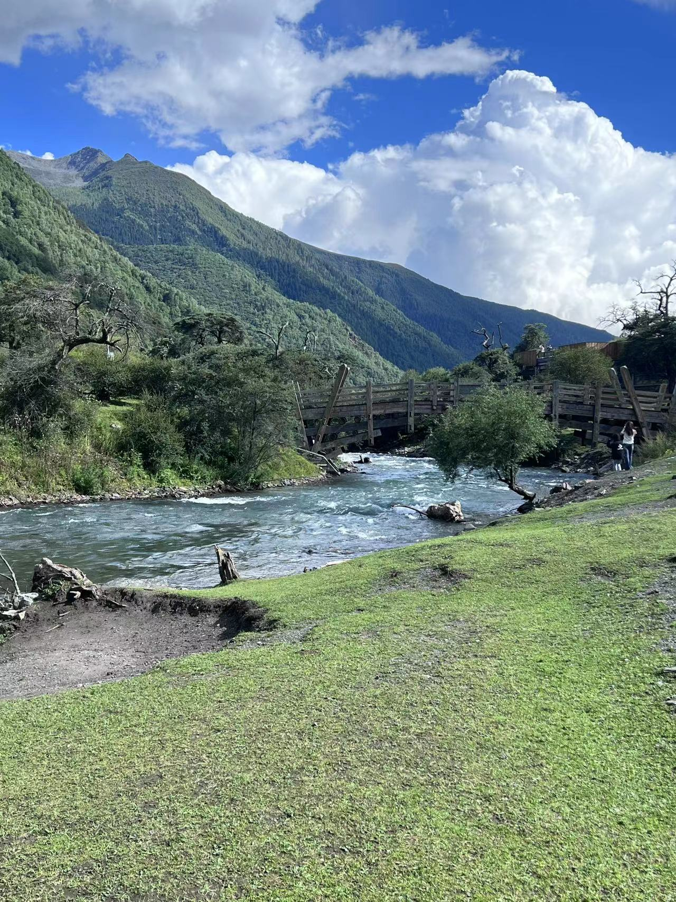

山是灰白的，水是青绿的。两天不算长，记住的颜色倒很清楚。
