# 西安与华山｜城里的灯，山上的云

2024 年 10 月 4 日 · 西安—华山

国庆走了一趟陕西：先在西安住下看夜景，再去临潼看兵马俑，最后上华山。从四日夜里到七日下山，天气一天比一天凉。

## 夜里到西安

晚上八点到钟楼。金顶被灯打成一片暖黄，斗拱和飞檐一层层亮着，红旗插在栏边，风一吹就摆。底下是转盘和车流，人都举着手机往上拍。

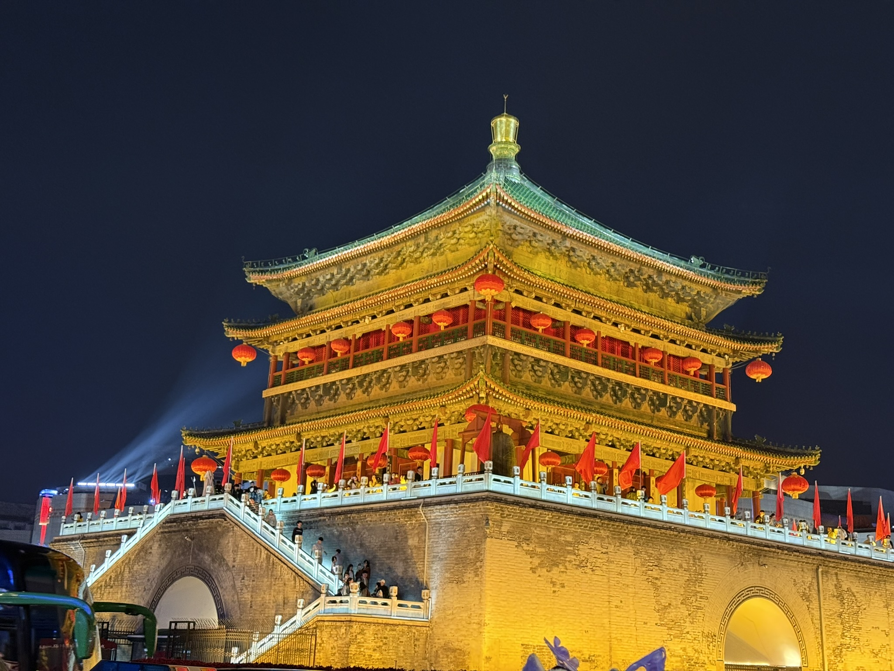

九点过，转到另一条街。树梢间垂着一排灯箱，黑底金字，写的都是诗：「碧池静照寒松」「清垒深沉佛殿灯」「一曲轱鸣两杖轻」。字是小楷，旁边还有更小的落款。

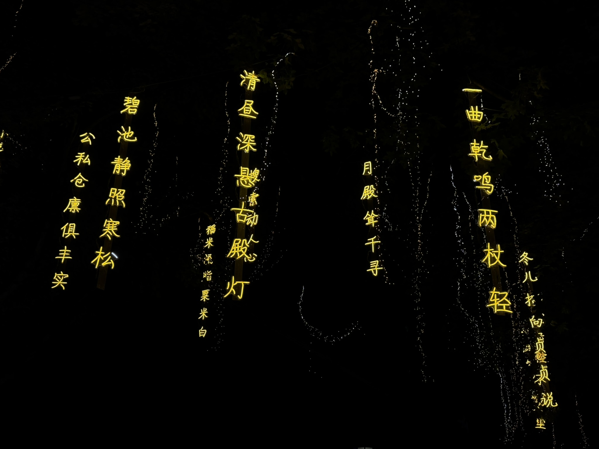

## 兵马俑

第二天上午十一点多到临潼。坑里没有想象中那么亮，光从侧面打过来，俑阵是灰的，一排排站着，脸都不一样：有的下巴宽，有的眉骨高，发髻偏左或者偏右。

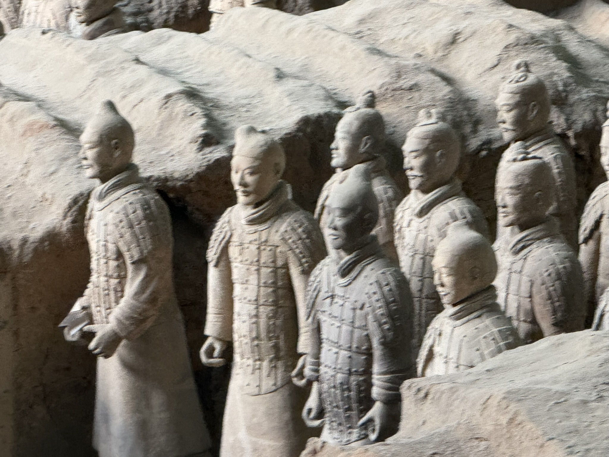
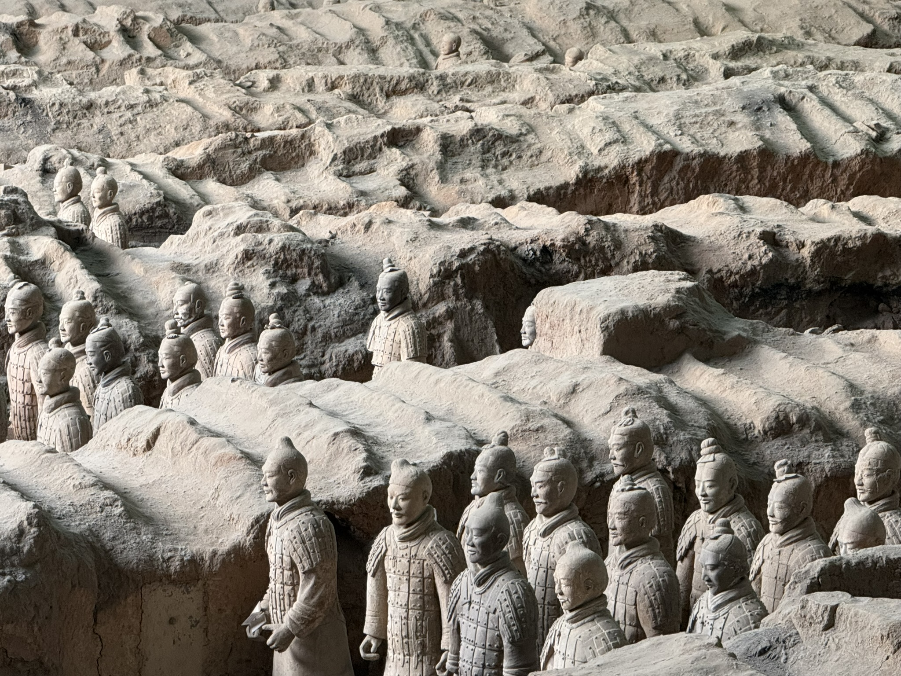

最前面那几排还能看清衣甲上的绳结和甲片，后面的就只剩轮廓了。隔着栏杆站了一会儿，没怎么说话。

## 华山｜抬头是山

七号上华山。上午十点半出索道站，抬头就是一片花岗岩。石壁灰白，被水冲出一道道竖纹；左边崖上有一组红墙灰瓦的建筑，顺着山势叠上去。

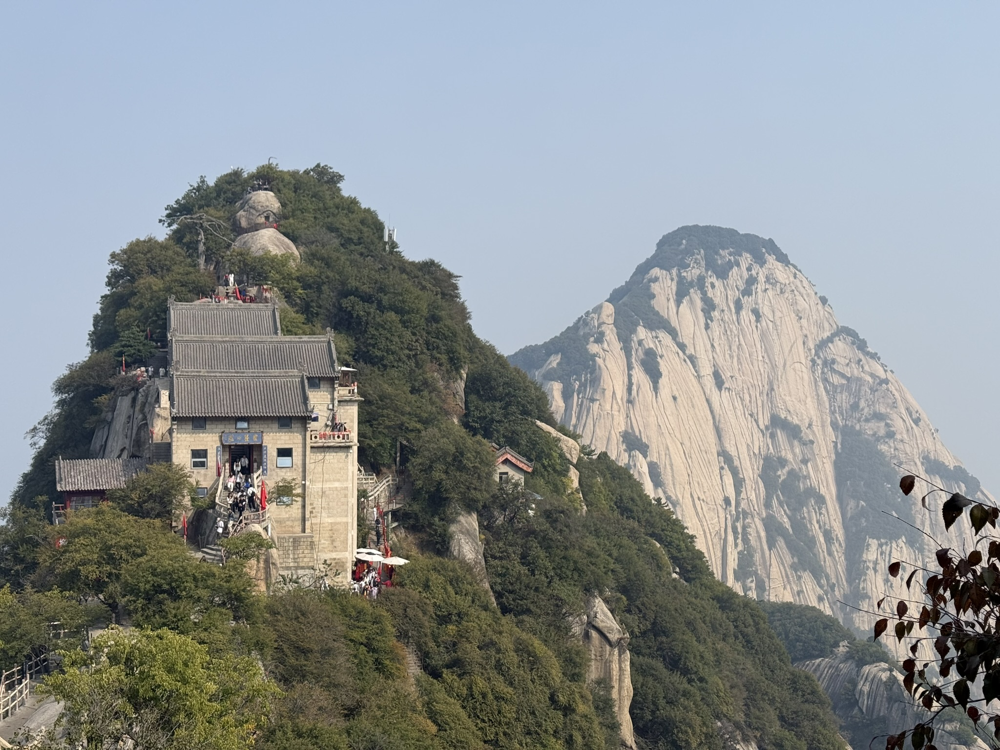

换一个角度，群峰在远处排开，峰顶都是圆的、钝的，不像别处那样尖。

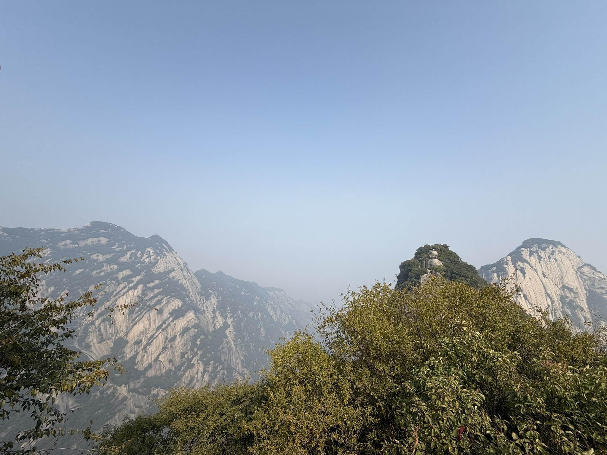

十一点，走到一处逆光的山口。太阳在雾后面，光把整面岩壁照成一片淡白，看不清细节，只看得见体量。

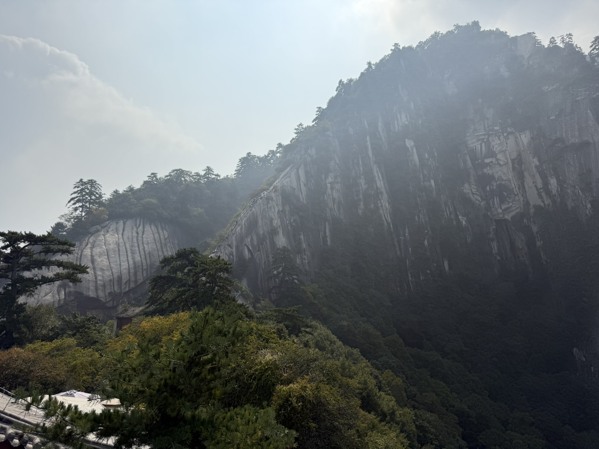

## 松树下的猫

十二点，在半山的平台上歇脚。一只橘褐色的猫蹲在花岗岩上，尾巴绕到前爪边，头顶垂着一枝松针。它不怕人，也不理人，就那么在石头中间坐着。

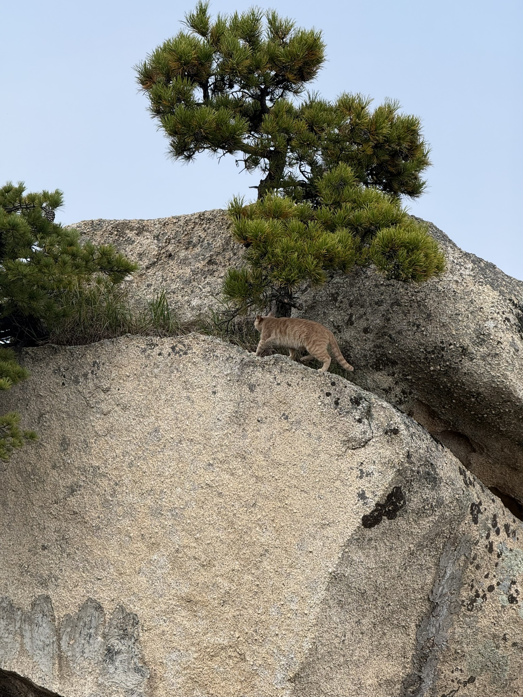

## 红丝带与云海

十二点半，走到一段崖边的栈道。松树的横枝从头顶伸出去，栏杆上系满红丝带，一层叠一层，被风吹得直响。

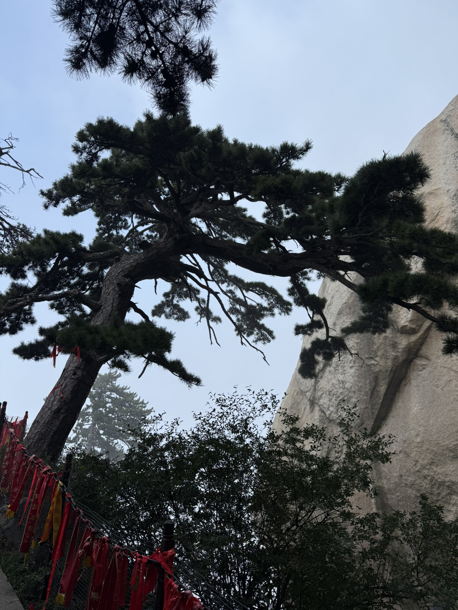

一点，云从底下漫上来。山谷先被填满，接着只剩几个山尖露在外面，像海里的岛。

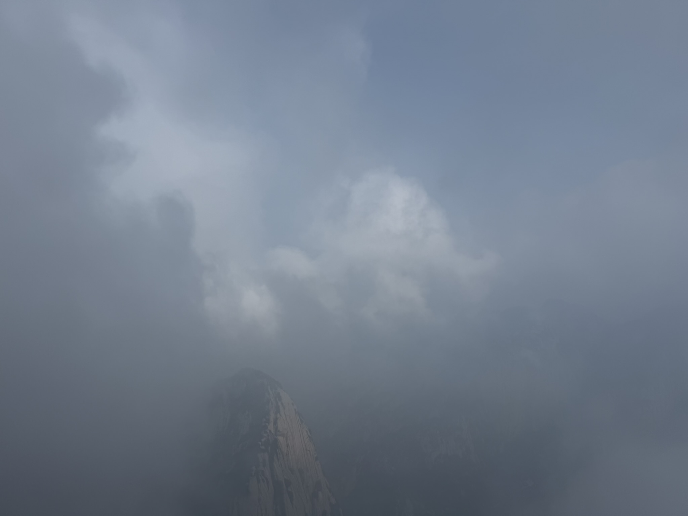

再往里走，雾就贴着树走了。松树成了剪影，远山的轮廓一层比一层淡。

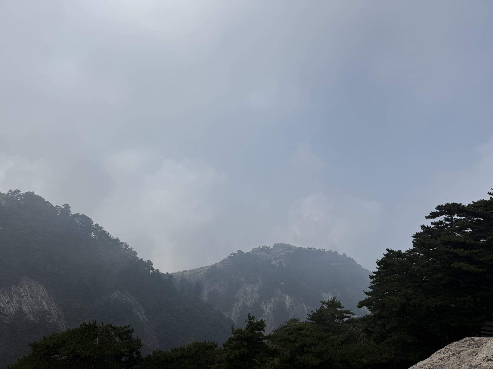

## 下山前

三点半，走最后一段石阶。崖边一株松树斜着长出去，树下面是一座金色屋顶的小亭，再往下全是云。

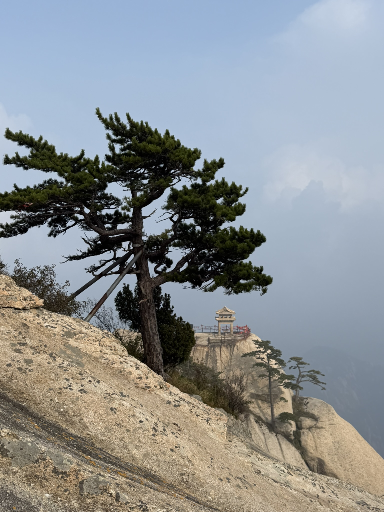

回到山脚已经五点。城里的灯、坑里的俑、山上的云，这几天穿的还是同一件外套，到了山顶就不顶用了。
