# 理小路｜秋色与初雪

2025 年 10 月 31 日 · 理小路

十月末走一趟理小路。上午在山脊附近是雪，下午下到河谷又是满山的秋色；第二天早上推开窗，雪比前一天又低了一截。

## 上午的雪

十一点二十，公路拐上一个缓坡，雾就跟上来了。路肩外侧的杉树挂满新雪，枝条被压得往下坠，树尖却还是直的。能见度不到百米，对面的山整个被雾吃掉，只剩下近处这几排树。

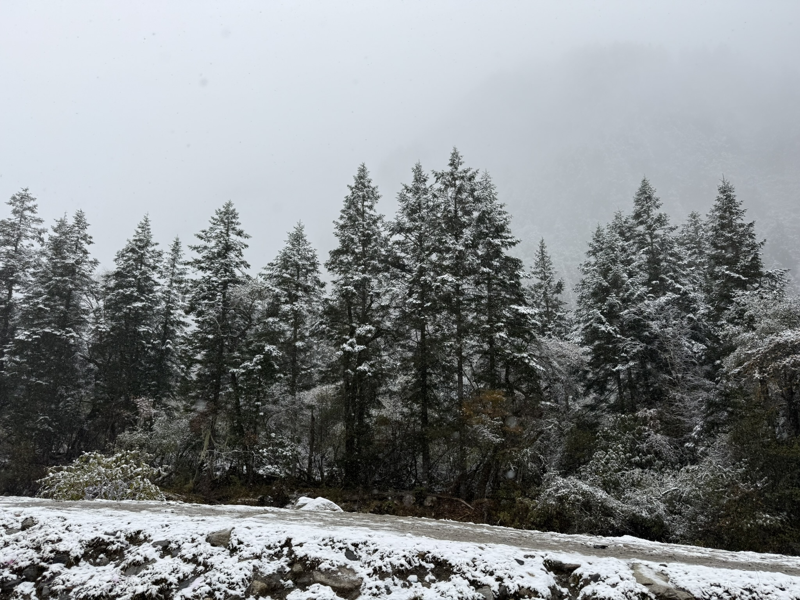

再往前，雪落在路边的灌木和草上，路面上反倒没有——车轮压过的地方露出黑色的沥青，还带着水光。风把雪吹成一堆一堆，堆在石头和护栏脚下。

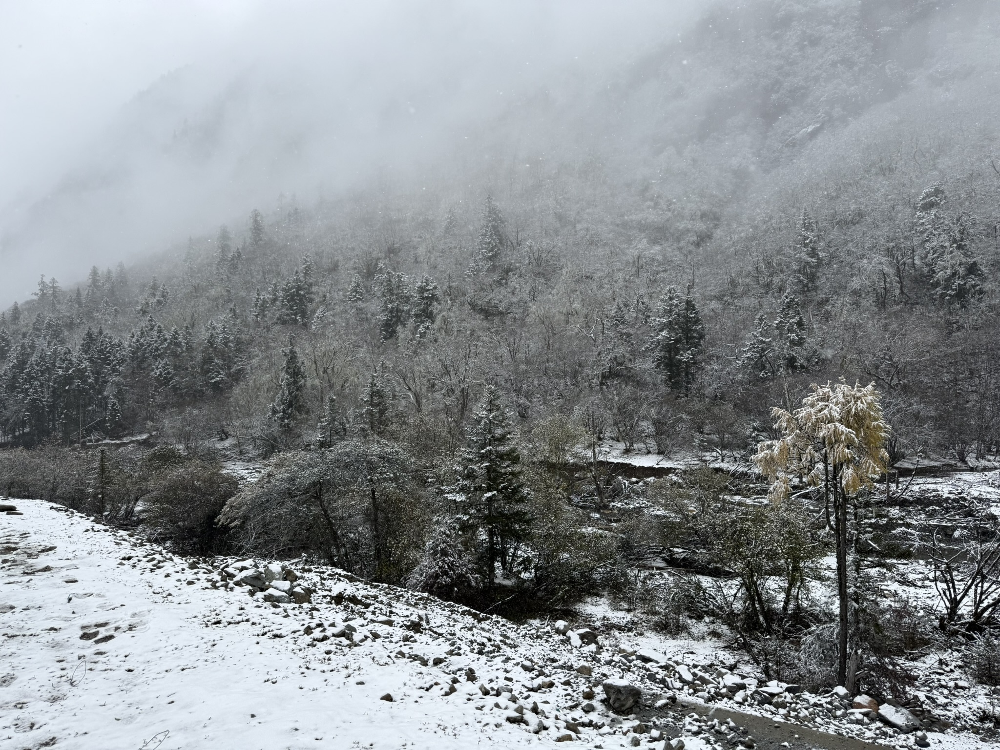

十二点过，雾更厚了一层。树只剩下轮廓，从近到远一层层淡出去，最后什么都没有。

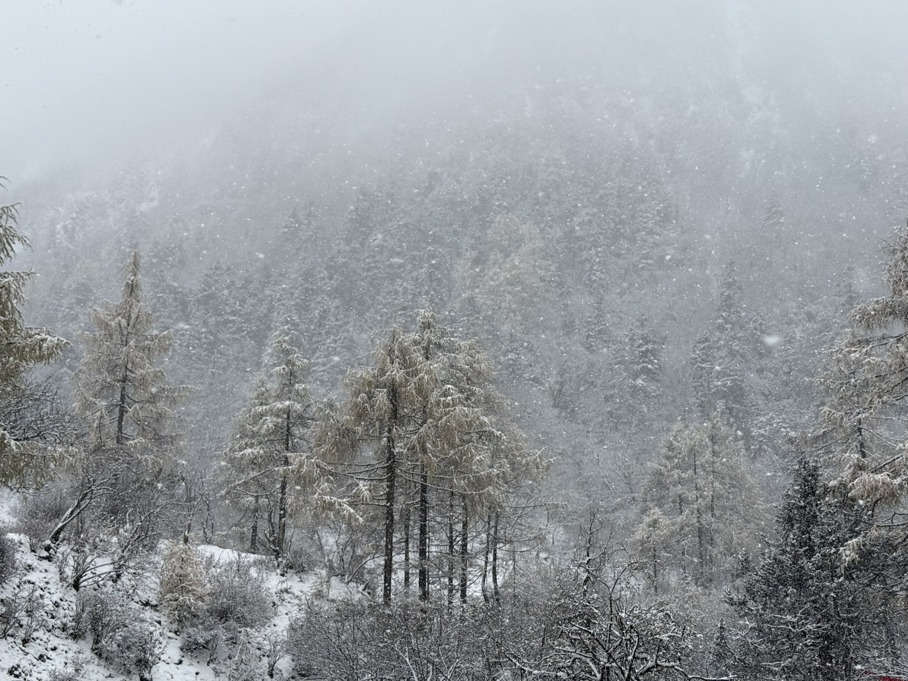

## 栅栏边的狗

十二点五十，路边一户人家的木栅栏前站着一只花狗。白脸、黑耳朵、黑背，前爪踩在水泥台阶上，一动不动地看过来。我们对视了几秒，它把脑袋偏了一下，还是没叫，也没往前走。

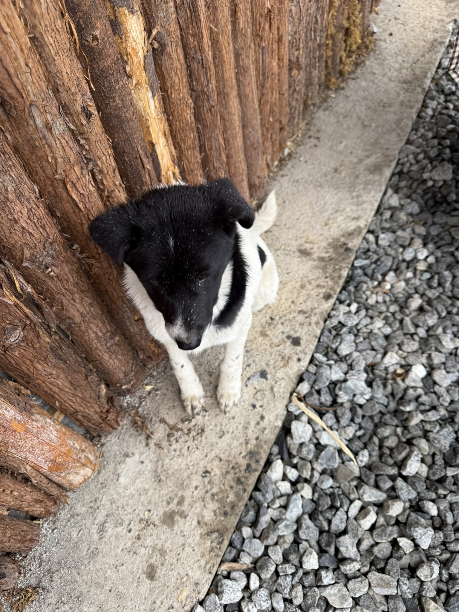

## 往下走，秋天又回来了

下午两点半，路开始往下盘。海拔一降，雪就没了，山坡上全是黄、褐、绿混在一起的颜色。河谷在下面，河滩是灰白色的砾石，水是青的，贴着石头分成几股往下走。

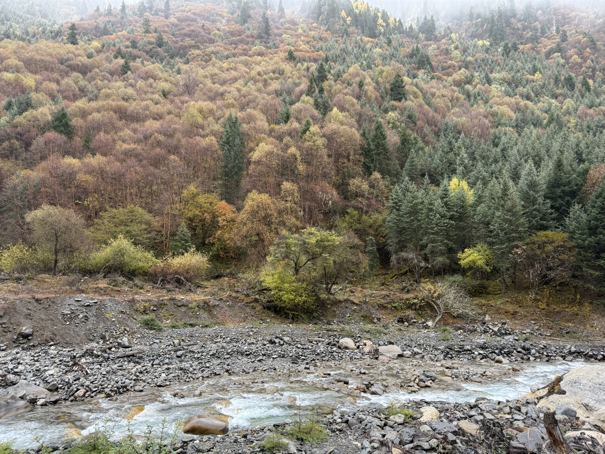
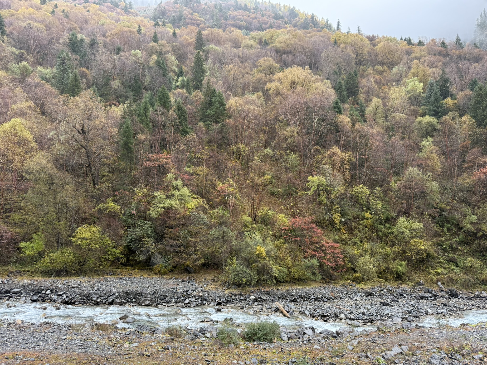

两点四十，走到公路的护栏边。外侧的山坡整个是金黄的，树冠一层压着一层，一直排到沟底。

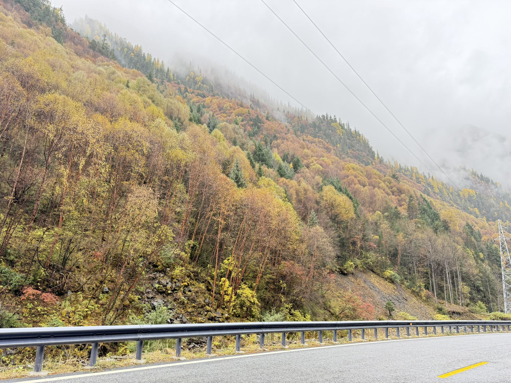

## 一锅红油

五点过，在路边的小店坐下。一大盆红油端上来，豆腐、血旺和肉片都沉在下面，辣椒段浮在最上面，油还在一鼓一鼓地滚。吃到一半把外套脱了——在山上冻了一整天，这一下才缓过来。

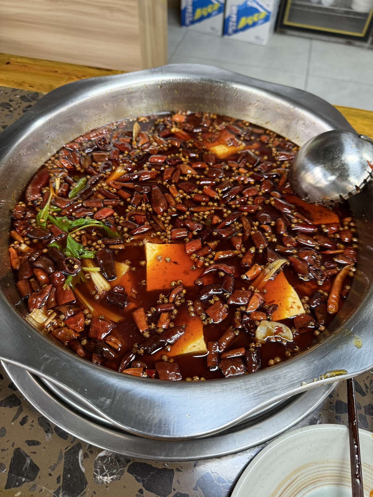

## 日落前，山头先白了

快六点，太阳低下去，雾散开一些。远处的山顶已经积了雪，山腰以下还是金黄。同一条山脊，上面是冬天，下面是秋天。

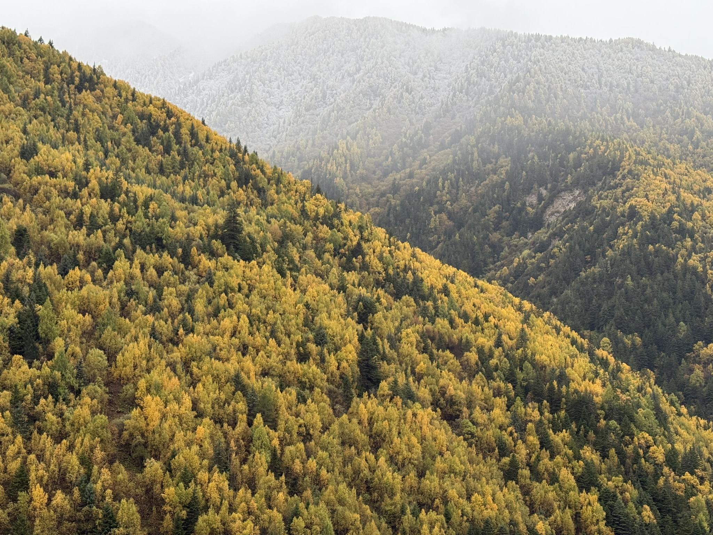

## 第二天早上，又是雪

十一月一日早上九点多，推开窗，雪线比昨天又低了一截。山谷两侧的灌木全白了，雾低低地压在中间，太阳在云后面，只透出一团亮。

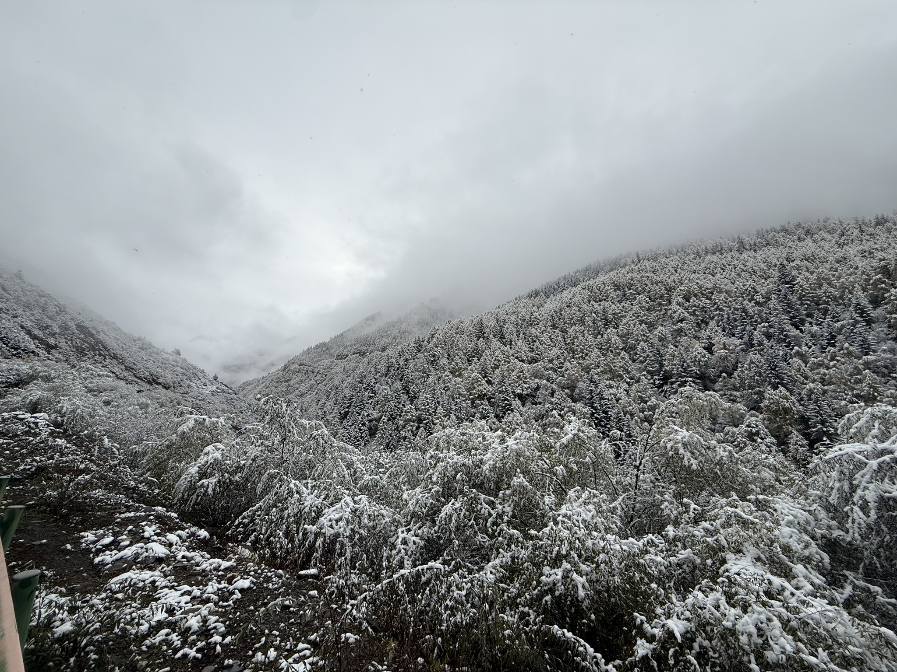
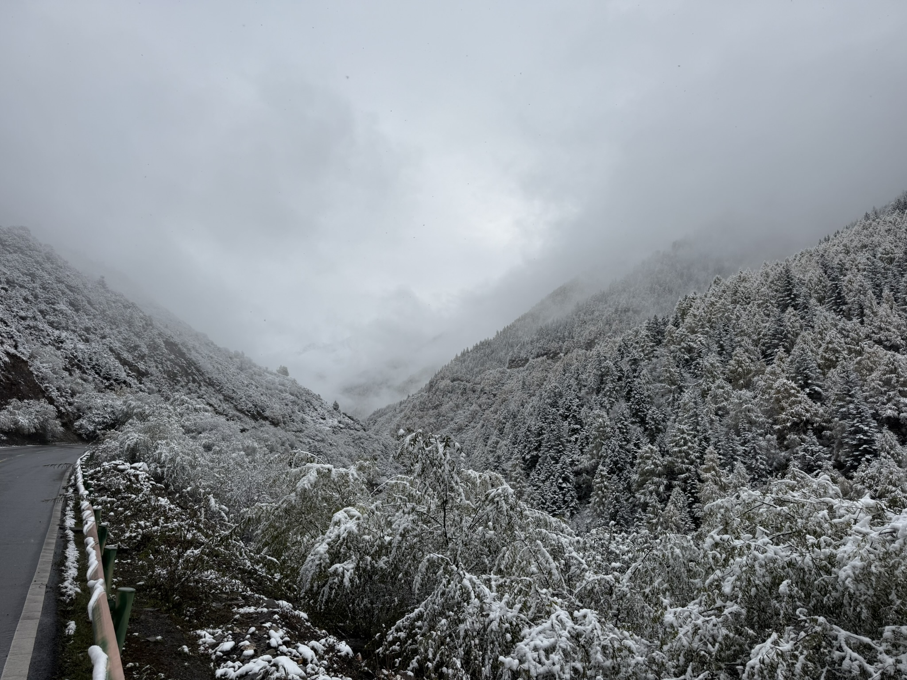

九点二十六，近处的枝上挂着一层雪，细枝被压得弯下来。一根电线从雪里穿过去，拉向山上。

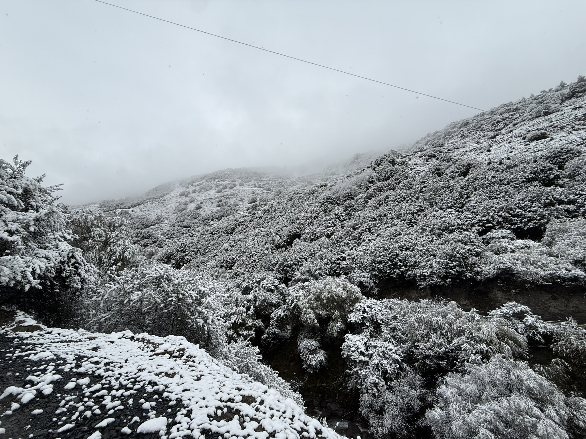

一天里走完两个季节。上车的时候，鞋底还带着雪，脚垫一会儿就湿了一片。
