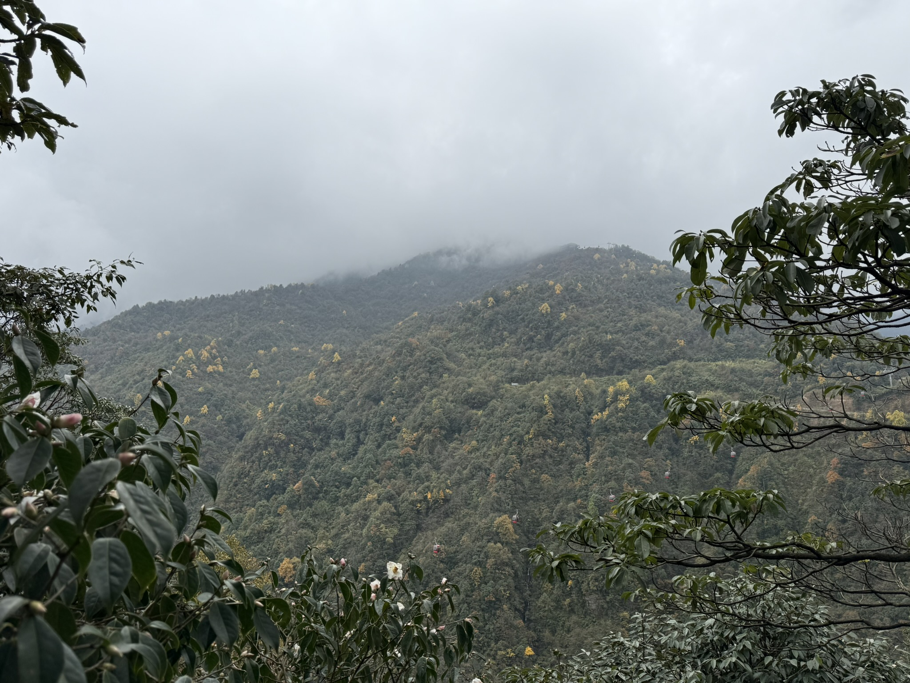
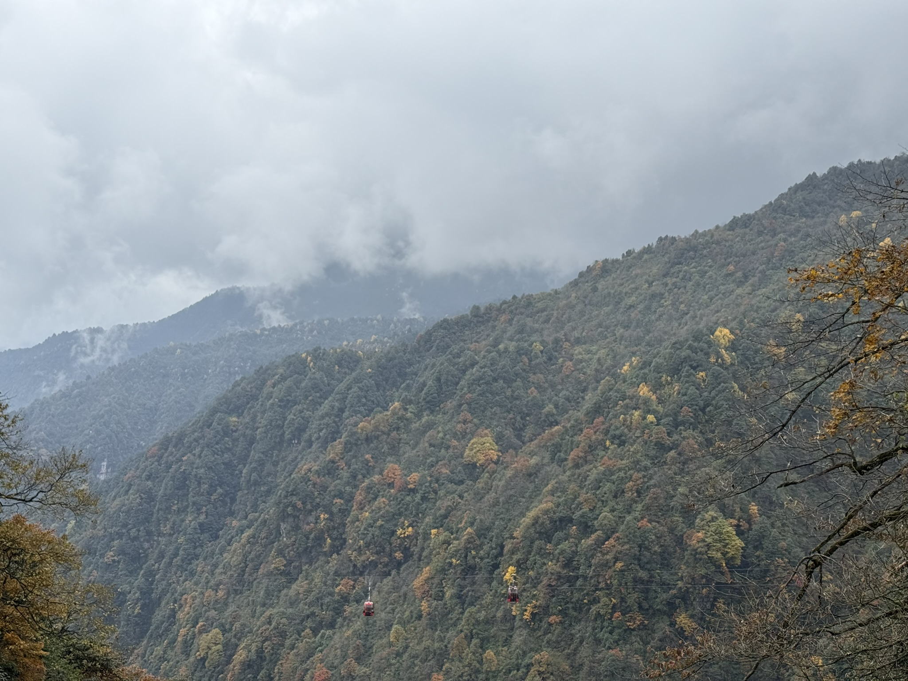
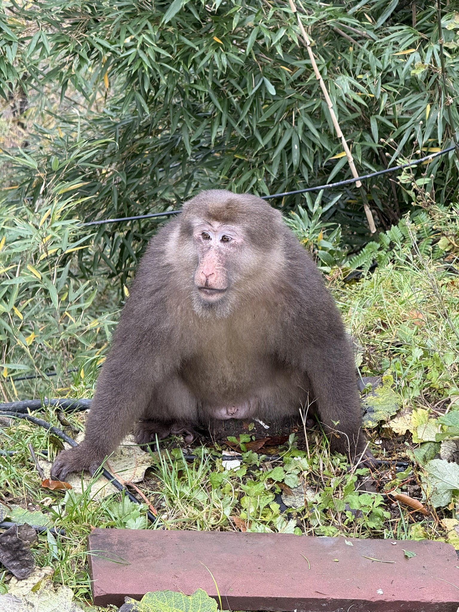
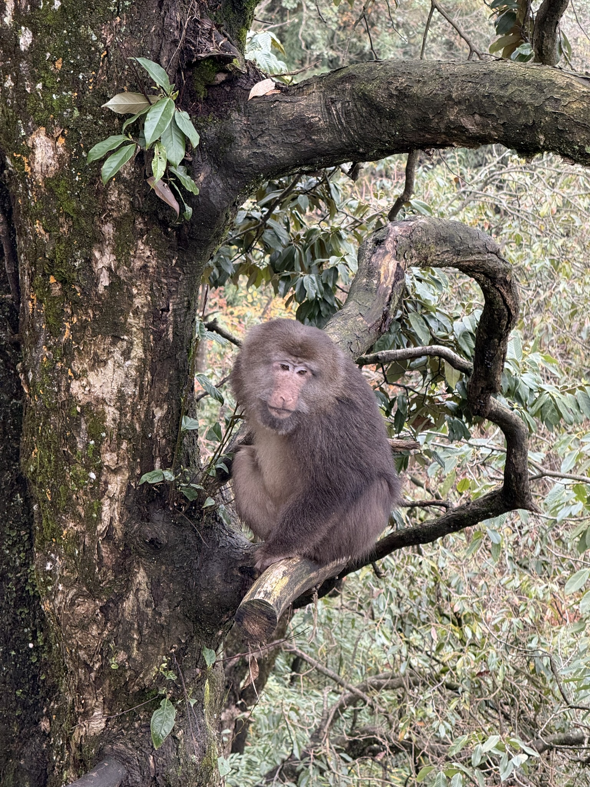
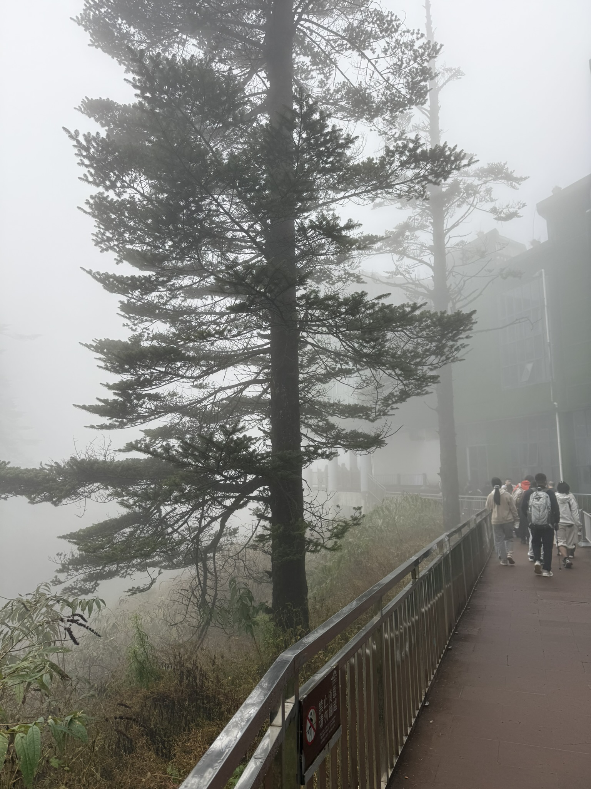
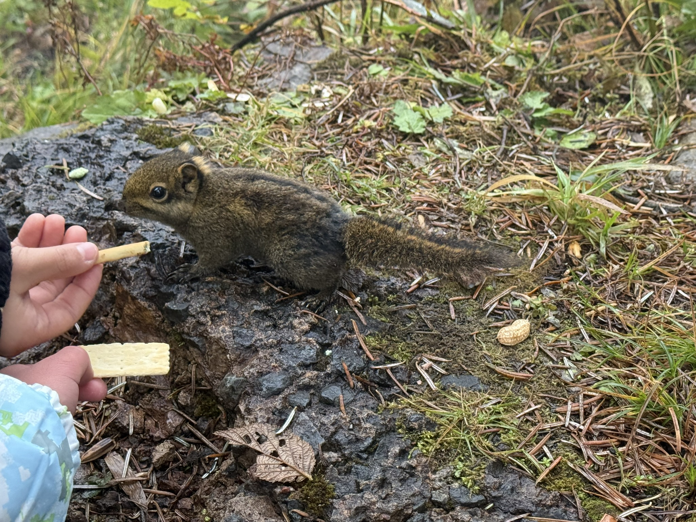
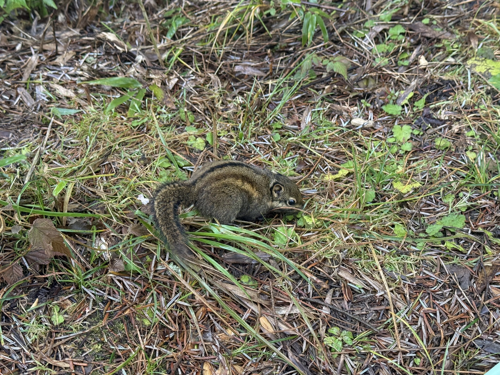
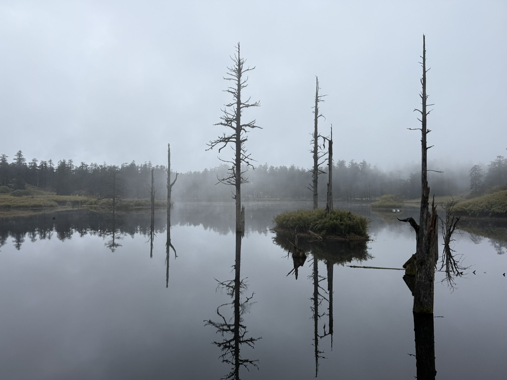
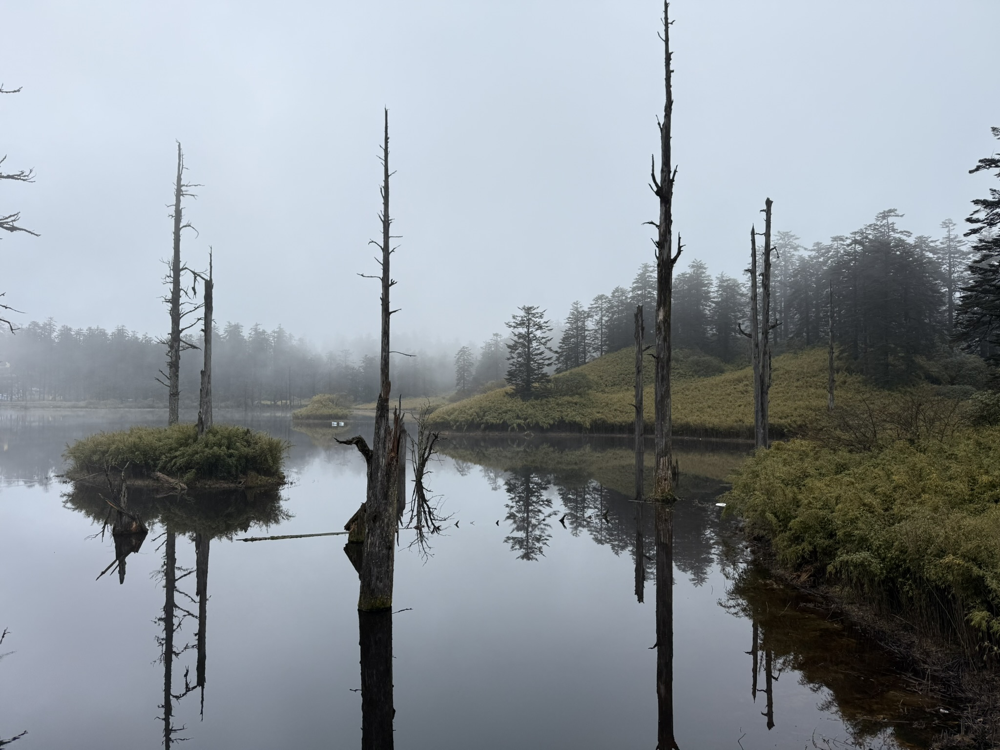
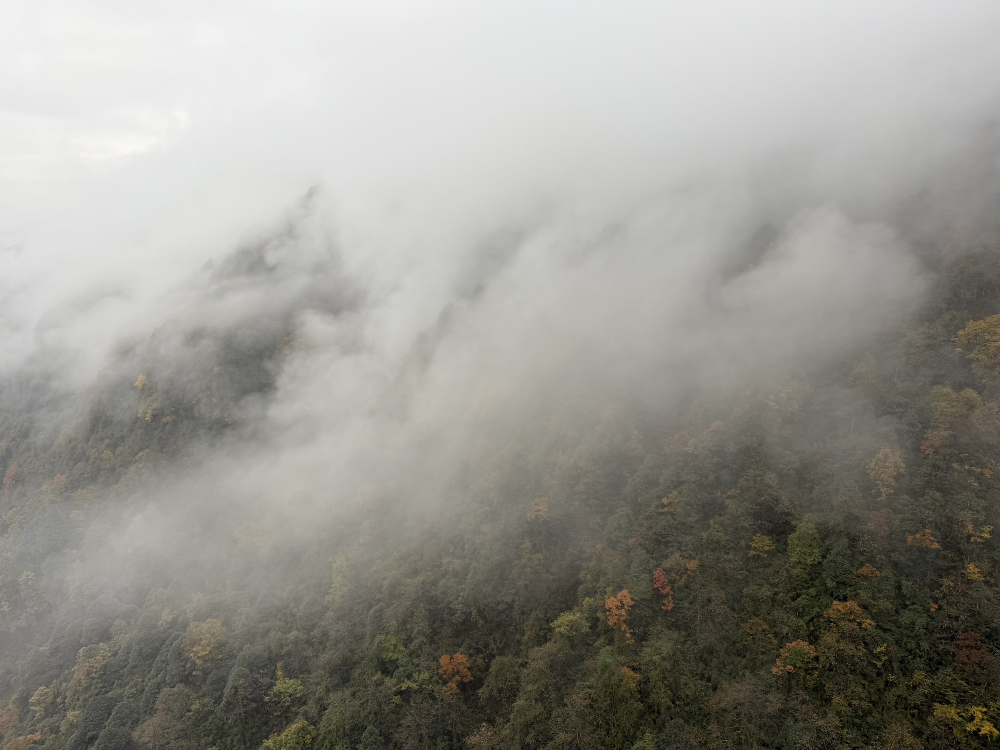

# 瓦屋山｜雾里的半日

2025 年 11 月 9 日 · 瓦屋山

周日。中午十二点半上到山顶，雾已经把山谷填满了。下午沿栈道往里走，路上遇见猴子和松鼠，一直走到鸳鸯池；五点多站在坡上，看云翻过山脊。

## 雾把山谷填满了

十二点半，索道到顶。山顶是一大片平地，站到栈道边往外看，雾正从谷底往上漫。山脊一层压着一层，颜色从深绿褪到灰白，最后连成一片。

## 路上的猴子

栈道边有一群猴子，不怕人。一只坐在草里，两只前爪撑在身前，直直地看过来；另一只蹲在斜伸出去的枯枝上，尾巴垂着，眼睛半闭，像在打盹。

## 观景台上的一顿饭

一点多，在观景台的木桌边坐下。一盒切好的鸡肉，旁边一只高脚杯，粉色的饮料气还没散。对面的山壁上挂着一条瀑布，细得像根线；山顶埋进云里，只看得见半坡的黄和绿。

## 栈道，和松鼠

三点半往里走。栈道贴着山壁，一边是冷杉，一边是空的。雾浓得只看得见十步远，树从雾里冒出来，像一根根竖着的黑线；前面几个人走着走着，背影就化进雾里。

栈道边的松鼠也不怕人。递过去一小块饼干，它用两只前爪捧着啃，尾巴一直翘着；另一只在草丛里翻找，背上的条纹看得很清楚。

## 鸳鸯池

再往里，栈道下到一片水面。山顶的鸳鸯池，水静得像块玻璃，湖心立着几根枯死的树，枝干光着，直直地插在水里，倒影和树一样高。对岸的冷杉在雾里一层层淡下去，水面上浮着一层薄雾，慢慢地挪。

## 云翻过山脊

五点十分往回走，云开始翻山脊。它沿着坡往上爬，一层压一层，翻过垭口就散开，露出下面的林子——黄、红、深绿，秋色混在里面。站了十几分钟，云又合上了。

这半天，看到的雾比山多。山顶那块平地很平，雾一起来，连远处的声音都没有了。山一直在那里，只是没打算给我们看。
