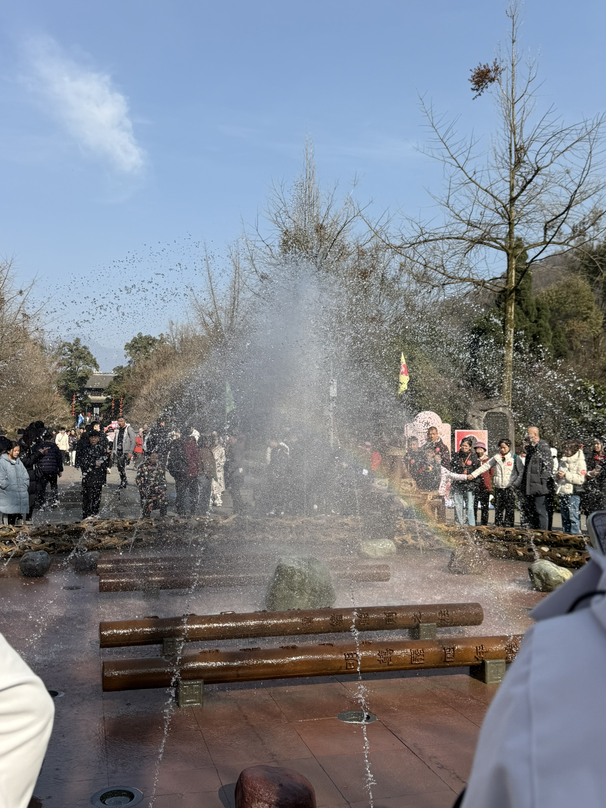
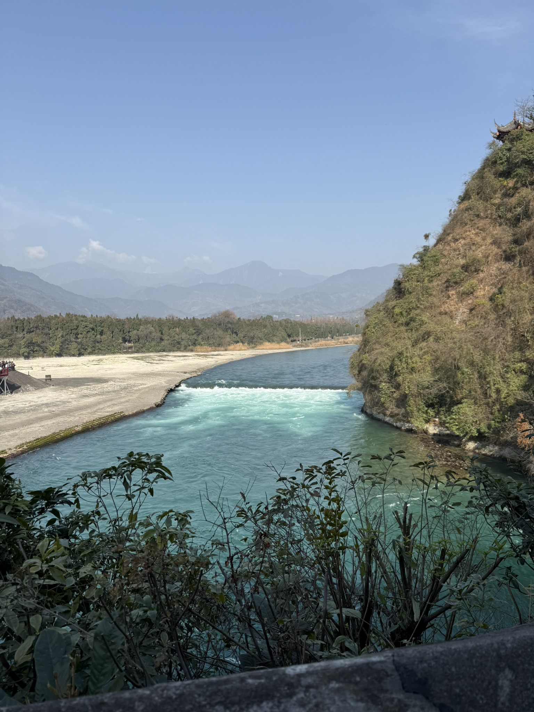
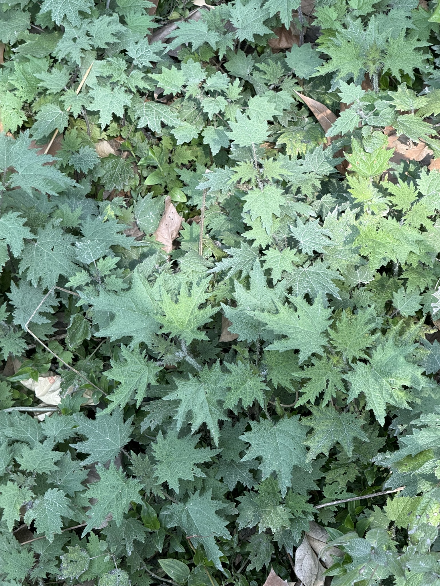
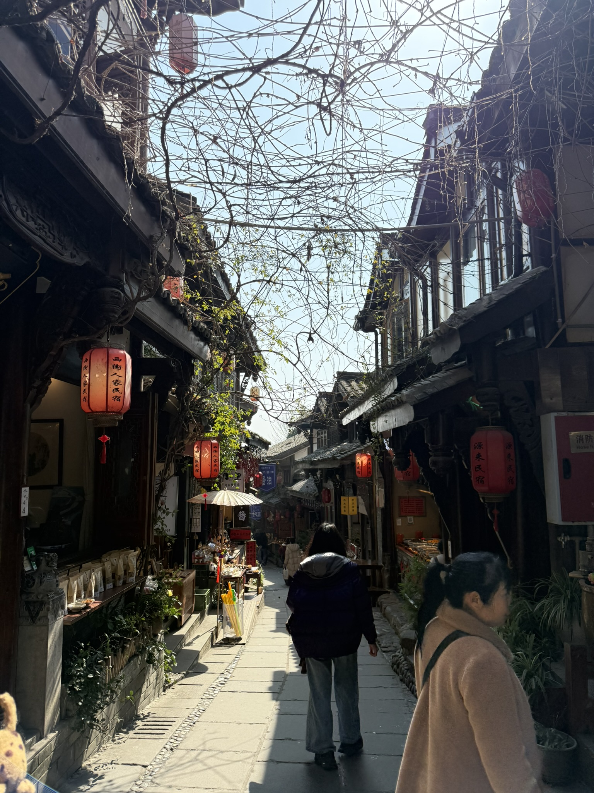
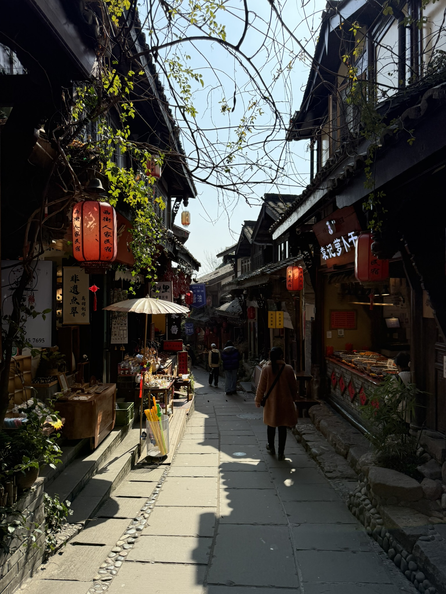
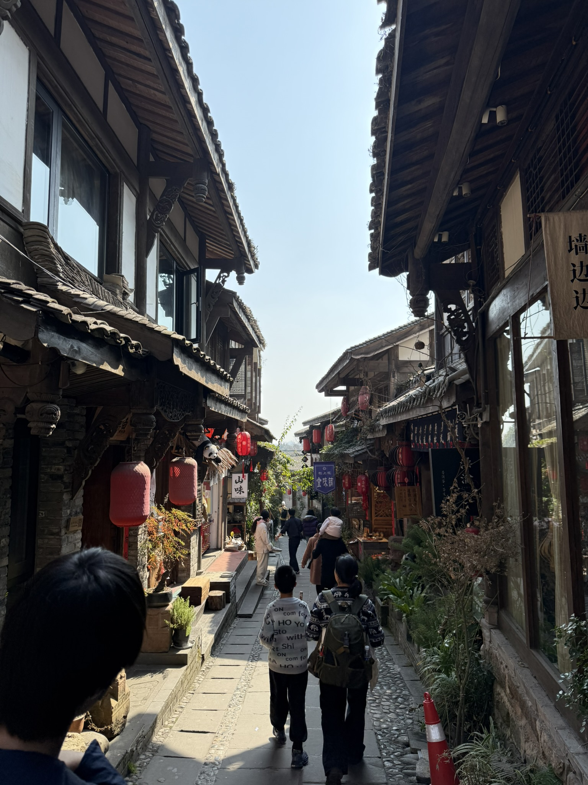

# 都江堰｜水到这里分了岔

2026 年 2 月 13 日 · 都江堰

周五，晴。上午十点四十五进景区，先在门口的水池边站了一会儿，再沿江往上游走，在宝瓶口和飞沙堰的栏杆前各停了一阵；中午拐进老街，晒着太阳走到快一点。

## 进门先看见水

十点四十五，检票进去是一个水池。池底横着三根粗家伙，铁身子上刻满了字，水从底下的小孔里直喷上来，散成雾，落在池边的石板上，湿了一片。围了一圈人在拍照，也有人伸手去接。

## 江是碧的

往里走，江面一下子开阔。水是碧绿的，从上游压过来，到堰前翻成一道白，白过去又沉回青绿。对岸的山陡起来，一坡灰褐的树还没绿，山顶上有座小亭子。远处的山影一层淡过一层，淡到只剩轮廓。

## 宝瓶口与飞沙堰

再往上是一处红栏杆的平台，栏杆边立着木牌，一块写着「宝瓶口」，一块写着「飞沙堰」。宝瓶口这一侧，江心立着一座石山，石壁上刻着「离堆」两个字，山上是伏龙观，重檐的屋顶压着一片绿。水从离堆和左岸之间挤过去，声音比看上去要大。

往前走几步就是飞沙堰。堰口放开，白浪一层压着一层往下翻，水声闷闷的。木牌上「飞沙堰」三个金字，旁边竖着一块「拜水都江堰」。二月的水量不算大，那股劲还在。

栏杆上贴着两句招人的话：「想你的风吹到了都江堰」。风确实有，吹在脸上是凉的。

## 一片叶子

十二点四十六，从景区出来，等同伴的工夫低头看墙根。一片叶子摊在光里，羽状裂开，叶脉清清楚楚，背面发白。二月里能看到这么新的绿，不容易。

## 老街

拐进老街，街面很窄，两边是木构的二层楼，屋檐挑出来，几乎要在头顶合上。红灯笼一串串挂着，枯藤从架子上垂下来，还没发芽。铺子卖山货、药材、竹器，门口摆着干货和盆栽。

再往里，一家门口挂着「山味」的木招牌，另一家挑出「墙边边」的布幌。一对父母牵着孩子往里走，走了几步，背影就小下去。

看了两个小时，堤和堰的名字记不太住，倒是记得水的三种颜色：上游是碧的，堰口是白的，到了宝瓶口又沉成青的。
