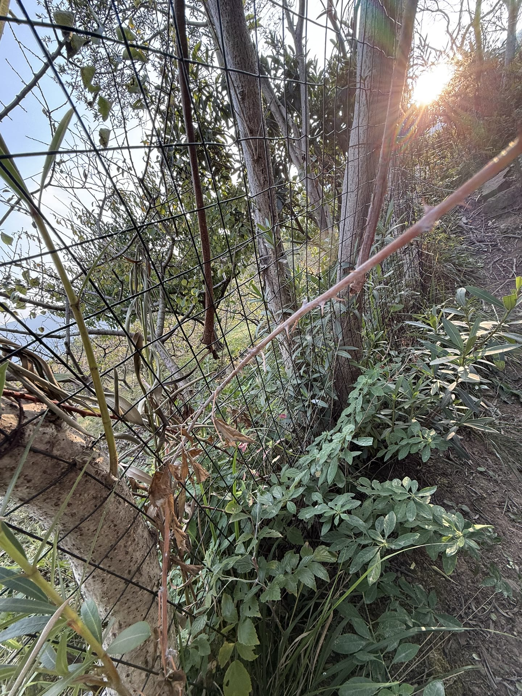
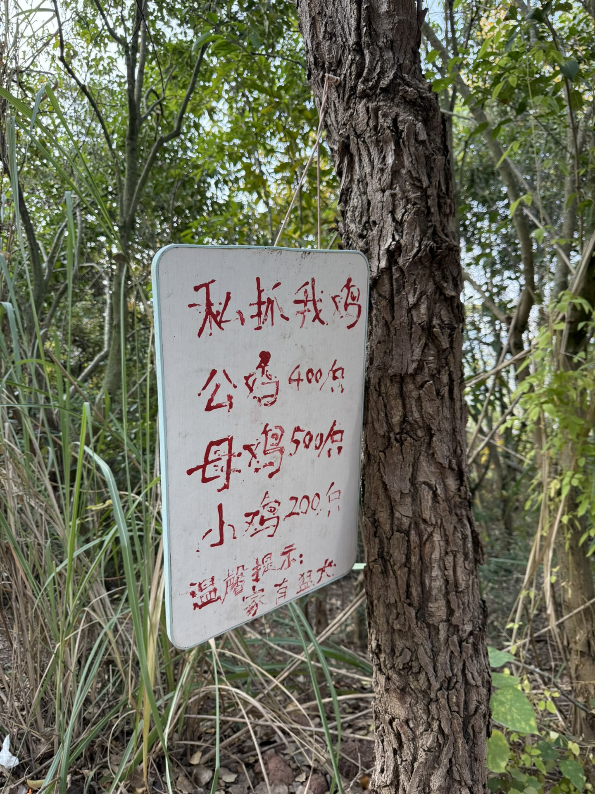
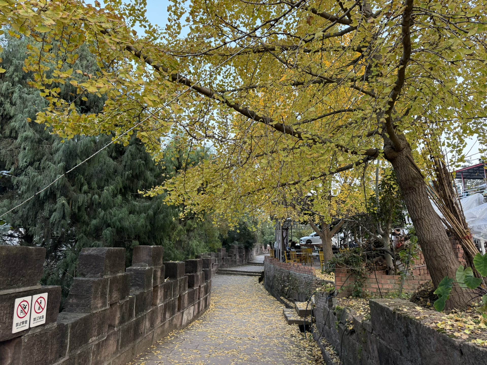
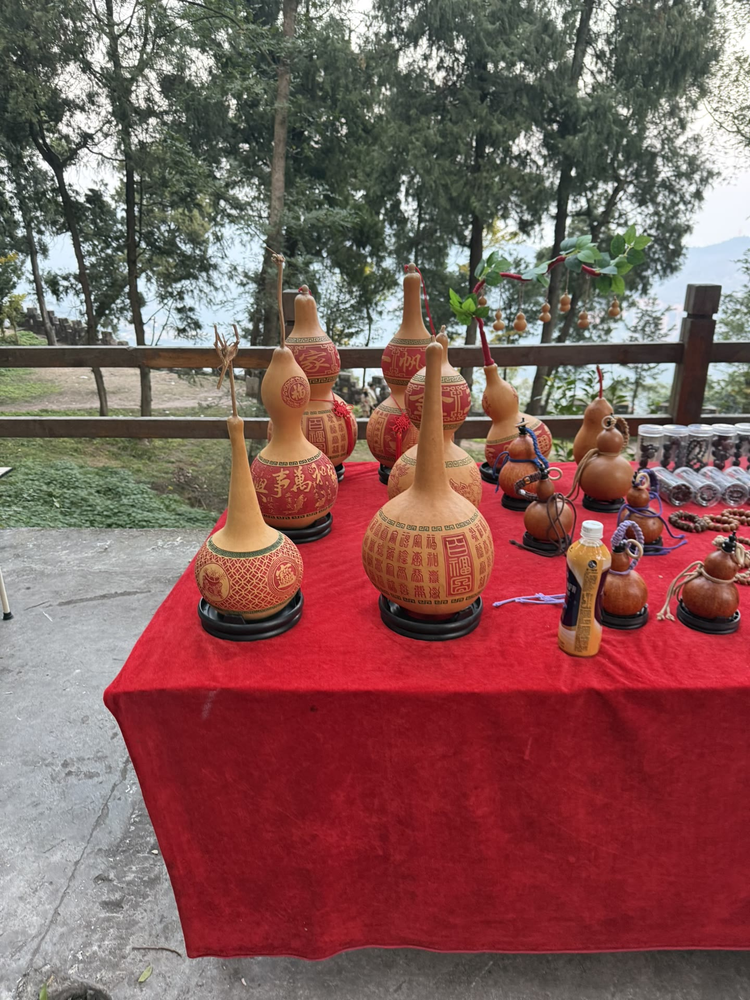
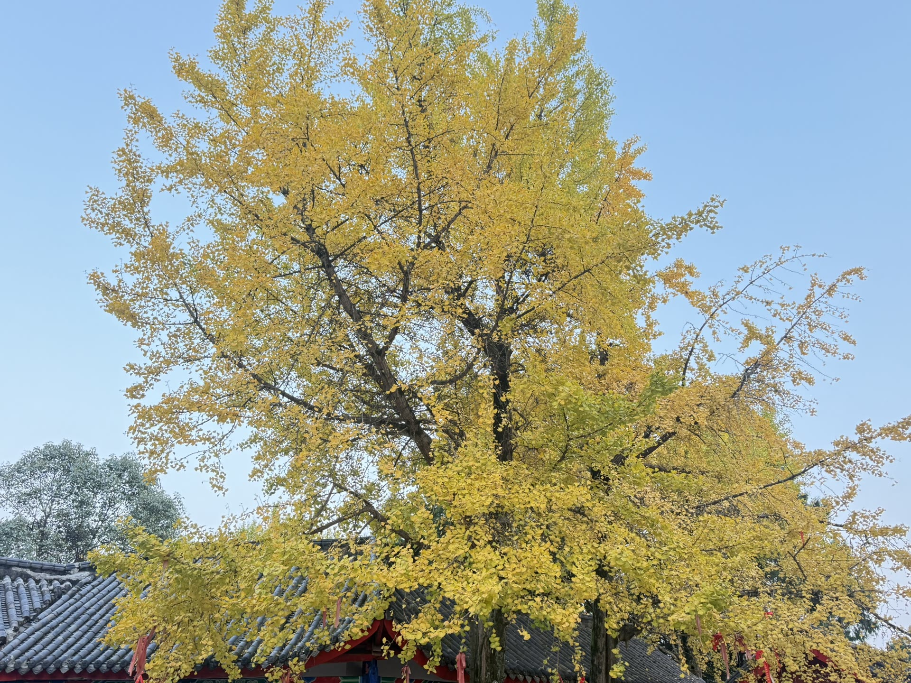
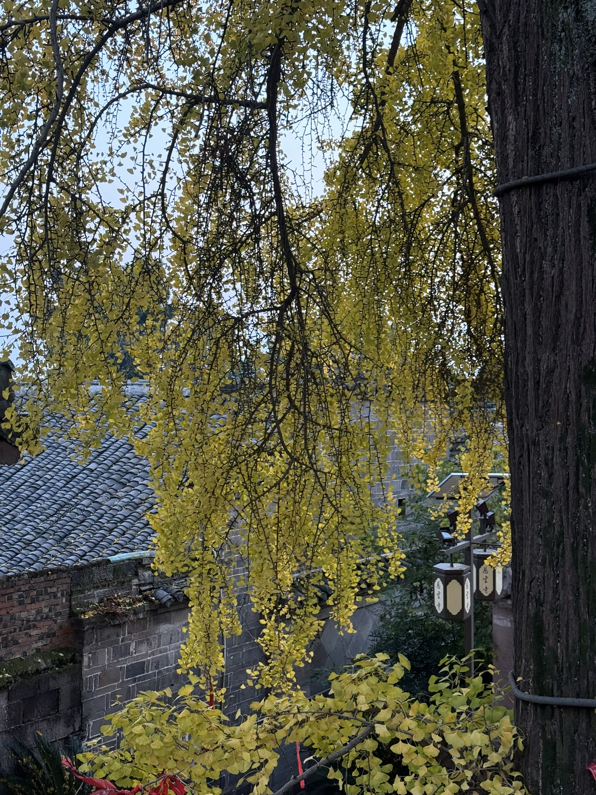
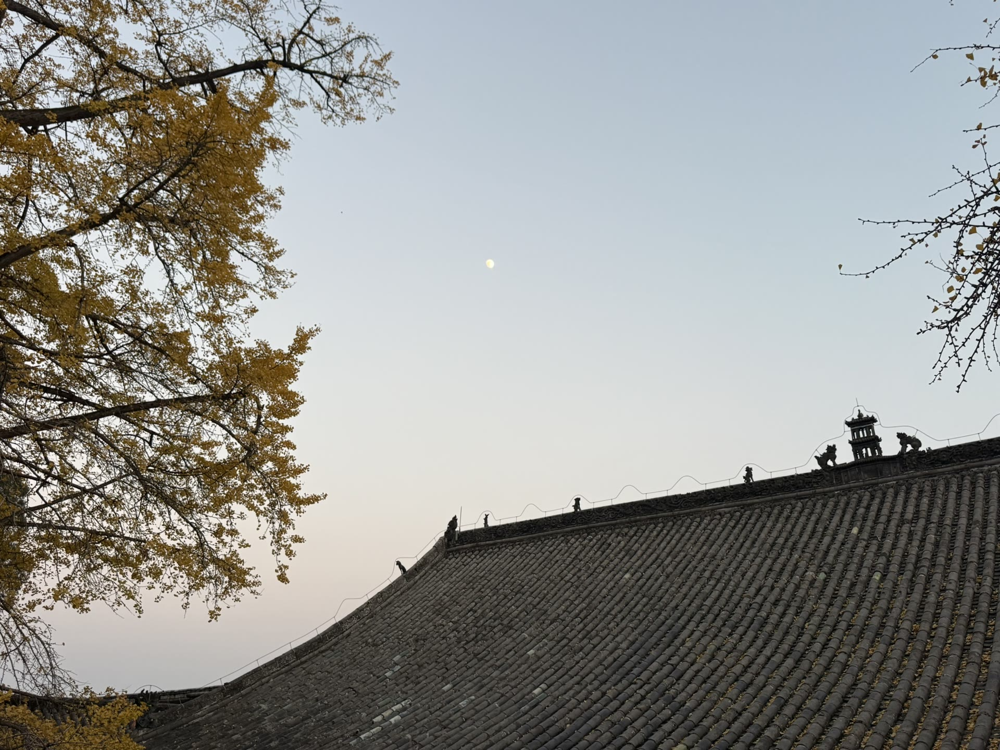
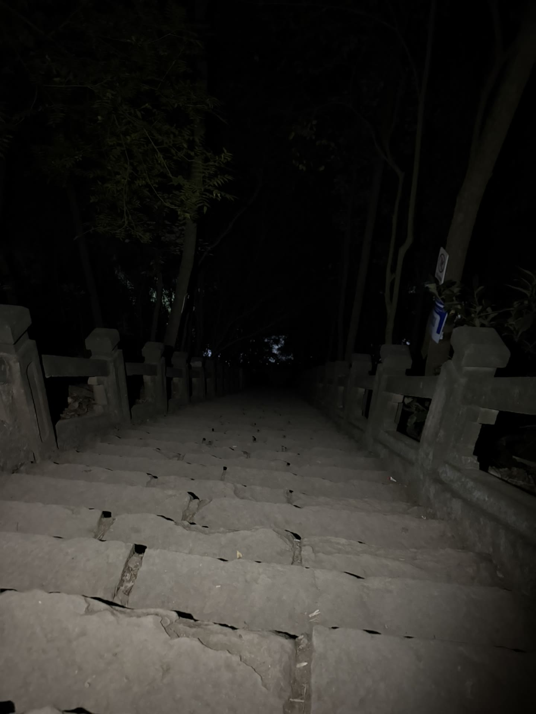

# 金堂云顶山｜银杏黄时，月上瓦檐

2026 年 11 月 21 日 · 金堂云顶山

下午四点前到龙脊古道入口，山脚的林子还是一片绿。五点半到了云顶石城一带，石墙边的银杏已经黄了。到慈云寺时天还亮着，灰瓦上方已经看得见月亮。

## 山腰那块牌子

四点一刻，沿龙脊古道往上走，太阳从树干中间漏下来，光落在斜坡上，坡脚还是暗的。再往前，树干上拴着一块白牌子，红字写了三行，公鸡、母鸡、小鸡各一个价。最下面还有一行小字，提醒家有猛犬。密密的树里，就这么一块白牌子，走过时很难没看见。

## 石墙边开始见黄

五点半过后，路边的颜色变了。石墙两侧还是深绿，墙外一棵银杏却把黄枝伸到了路上。靠墙的地方积着一层叶子，中间还有一条石路露出来。

<video controls playsinline preload="metadata" poster="../static/travel/2026-11-21-yundingshan/IMG_1042.jpg" data-place="云顶石城 · 石墙旁银杏" aria-label="仰拍银杏树冠的实况短片">
  <source src="../static/travel/2026-11-21-yundingshan/IMG_1042.mp4" type="video/mp4">
</video>

快六点，快走到慈云寺了，路边一张红布上摆着一排葫芦。大的在后面，小的放在桌沿，几个底下还垫着小座。再抬头，一株银杏的树冠几乎占满了眼前那片蓝天。

## 慈云寺的灰瓦和月亮

六点过，走到慈云寺大雄宝殿后的银杏院，院里已经有了暮色。几串细枝从高处垂下来，叶子伸到灰瓦前面。往上看，粗树干分出几道长枝，枝间透出一点天光，靠近檐口的叶子还黄着。

<video controls playsinline preload="metadata" poster="../static/travel/2026-11-21-yundingshan/IMG_1054.jpg" data-place="慈云寺 · 大雄宝殿后院" aria-label="慈云寺瓦檐旁银杏的实况短片">
  <source src="../static/travel/2026-11-21-yundingshan/IMG_1054.mp4" type="video/mp4">
</video>

六点零八分，月亮已经露在屋脊上方。树枝从左边伸过来，瓦檐从右边斜上去，中间留着一小块淡蓝色的天。

## 摸黑下石阶

晚上八点十八分，回到龙脊古道靠近山脚的一段石阶。脚下只亮着几级，石栏再往前就隐进了黑里。傍晚那点亮色还在屋脊上，夜里再拍，画面里只剩一段段往下走的路。

